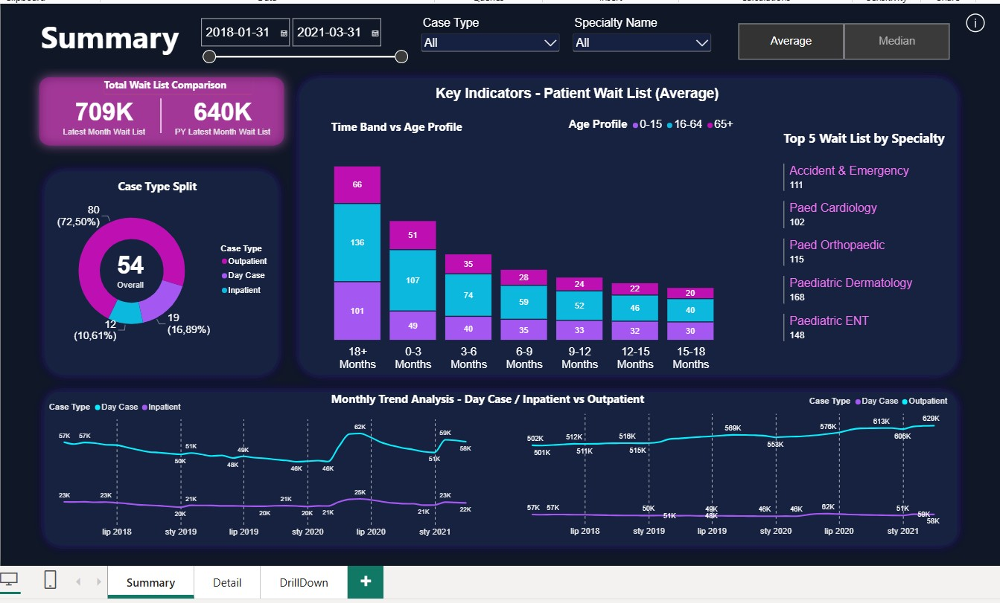
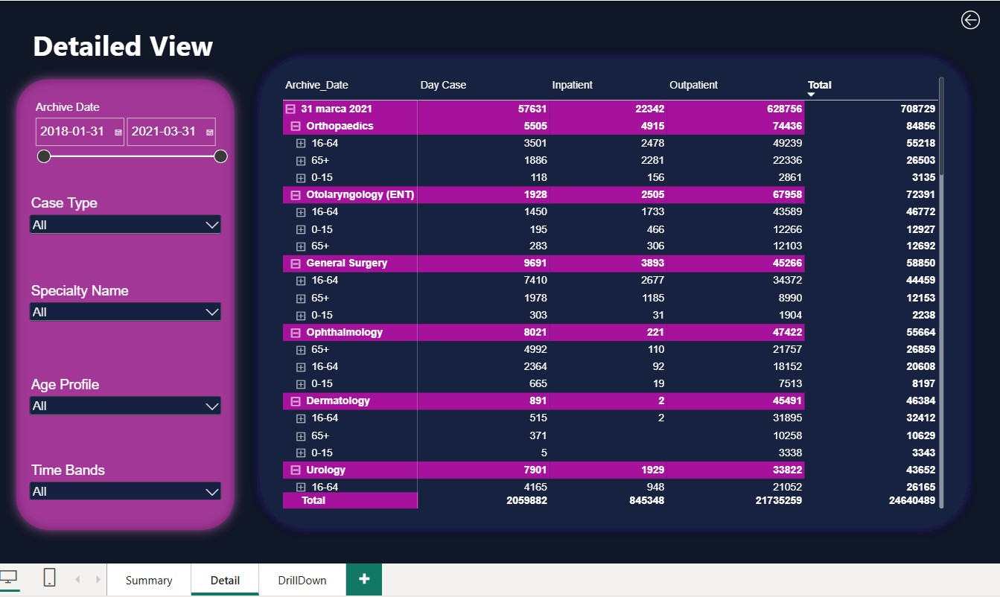

# Hospital Waiting List Analysis | Power BI

## Project Overview
This project analyzes hospital waiting lists from 2018 to 2021 using Power BI.

- **Inpatient:** Patients admitted to a hospital for treatment.
- **Outpatient:** Patients receiving medical treatment without hospital admission.
  
- **Day Case:** Patients admitted for a single day.
- **Inpatient (length of stay):** Patients admitted for more than one day.

## Project Goals
- Monitor the current status of patient waiting lists.
- Analyze monthly waiting list trends for Inpatient and Outpatient categories.
- Explore waiting lists by medical specialty and patient age profile.

## Key Metrics
- Current Total Waiting List
- Average Waiting List
- Median Waiting List

## Dashboard Views
- **Dashboard:** Summary of key metrics and waiting list trends.
  

- **Detailed View:** Granular analysis by specialty, age profile, and patient category.

## Tools
- Power BI
- Power Query
- DAX
